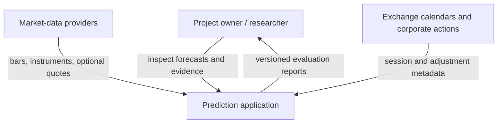
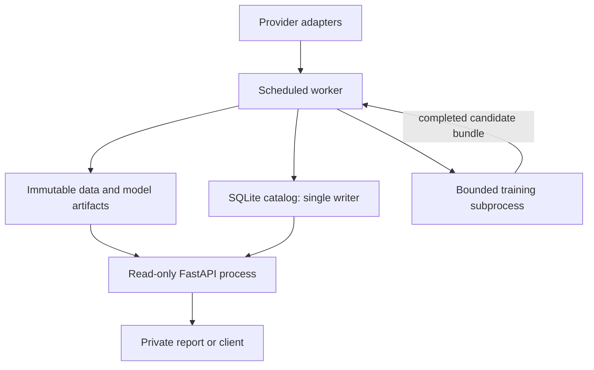
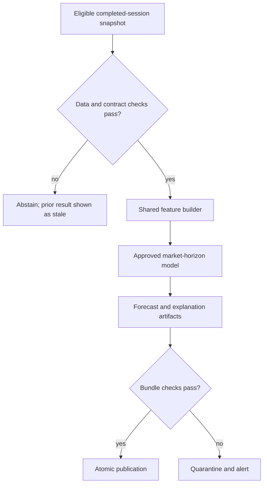

# Stock Market Prediction — Architecture

**Status:** proposed implementation blueprint; council-reviewed, not an implemented or benchmarked system.  
**Version:** 1.0 — 7 October 2026.  
**Audience:** developer, research reviewer, and project owner.

## 1. Goals and agreed decisions

Build a reproducible research and private forecasting application for Indian and US equities, with adapters for additional markets later. Produce return forecasts for 1, 5, and 21 trading sessions, explain the forecasts, and evaluate them on chronological unseen data.

| Decision | Architecture commitment |
|---|---|
| Main prediction family | Regularized LightGBM regression, fitted separately by market and horizon |
| Fallback family | Ridge regression with its own fitted preprocessing and independent validation |
| Horizons | Direct 1-, 5-, and 21-session forecasts; no chaining of daily predictions |
| Explainability | TreeSHAP for LightGBM; LinearSHAP or centered linear contributions for Ridge |
| Research data | Daily OHLCV and local market context first |
| Initial geography | India and US independently; global adapters are optional extensions |
| Delivery | Private API and forecast report; optional live quote display |
| Architecture style | Modular Python monolith, separate worker and API processes |

One model family does not mean one fitted estimator: the initial design has three main estimators and three fallback estimators per market. Selection is horizon-specific; Ridge may win a horizon even when LightGBM wins another.

Prediction accuracy, explanation quality, and trading profitability are separate outcomes. No profitable edge has been established. Initial scope excludes order execution, intraday prediction, guaranteed confidence probabilities, public data redistribution, neural models, and sentiment/fundamental hybrids without suitable historical data.

Planning assumptions: one developer/small team, 4–8 CPU cores, 16 GB RAM, roughly 50–100 liquid stocks per market, 2016 onward where available. These are sizing assumptions, not measured capacity. Historical membership and inactive instruments must be audited before claiming an unbiased index-universe backtest.

## 2. Architecture process and principles

Use a lightweight arc42 structure, C4-inspired context/runtime views, and architectural decision records (ADRs). Context and runtime views explain the system; module contracts explain implementation responsibilities. Do not replace architecture reasoning with a technology list. [S1–S4]

| Step | Required output | Review question |
|---|---|---|
| Define scope and stakeholders | Forecast target, audience, constraints, non-goals | What exact result is the system responsible for? |
| Define quality goals | Measurable acceptance scenarios | Which failures would invalidate the research or mislead a user? |
| Identify boundaries | Providers, domain modules, stores, runtime processes | Who owns each piece of state and each transformation? |
| Define contracts | Typed records, versions, temporal semantics | Can a result be traced to exactly what was known and used? |
| Walk through runtime scenarios | Ingest, train, forecast, explain, fail, recover | What happens during partial success or missing inputs? |
| Compare alternatives | ADRs with rationale and consequences | Is added complexity justified by current requirements? |
| Build a vertical slice | One instrument, one horizon, full lineage | Does the design work end to end before widening scope? |
| Evaluate and revise | Tests, measurements, risk register, updated ADRs | Which assumptions did implementation disprove? |

Prioritize temporal correctness and reproducibility over optimistic latency. Keep research code reusable in inference. Preserve immutable evidence. Start with inexpensive infrastructure and extract services only after measured contention or operational needs justify them.

### Council critique incorporated

| Challenge | Accepted design response |
|---|---|
| A backfilled dataset does not prove historical availability | Separate retrospective research from replay using prospectively captured vintages |
| Daily inference and live quotes have different semantics | Keep separate pipelines, records, freshness indicators, and UI labels |
| Multiple processes writing a shared analytical database are fragile | Immutable Parquet, process-local DuckDB, one SQLite metadata writer |
| Switching models does not repair stale market data | Abstain on invalid inputs; Ridge fallback only on valid inputs |
| Overlapping monthly outcomes are not independent trades | Purge by label availability; explicitly model portfolio capital and rebalance frequency |
| Large SHAP contributions do not prove useful features | Validate incremental usefulness with grouped ablation and retraining |

## 3. Quality goals and acceptance scenarios

The latency and recovery numbers below are proposed engineering targets to benchmark. They are not market-data-provider guarantees. [S2]

| ID | Stimulus | Required response / acceptance |
|---|---|---|
| Q1 Temporal correctness | A feature source is published after forecast cutoff | Reject that observation from the feature row; automated invariant checks pass |
| Q2 Training correctness | A 21-session target is not yet observable | Exclude it from fitting, preprocessing, and tuning outcomes |
| Q3 Reproducibility | Replay a frozen run on the same pinned environment | Predictions match within `atol=1e-8, rtol=1e-6`; deterministic CPU settings/seeds recorded; investigate failures |
| Q4 Idempotency | Provider page/job is retried | One logical canonical version per content revision; no duplicate forecasts for the same publication key |
| Q5 Data safety | Required completed session is missing or invalid | No new ready forecast; preserve prior result with its original timestamp and stale status |
| Q6 Explainability | A forecast has an explanation | Reference plus signed contributions equals prediction within declared tolerance; unit/horizon/model identity match |
| Q7 API response | Cached forecast request on target hardware | Proposed p95 below 500 ms under a recorded load profile; benchmark before claiming compliance |
| Q8 Forecast freshness | Required eligible bars are available | Proposed publication within 45 minutes; ingestion readiness and deadline measured separately |
| Q9 Crash recovery | Worker dies during publication | API sees complete old/new artifact or unavailable status, never partial output; reconciliation completes before readiness |
| Q10 Restore | Restore a backup to a clean machine | Proposed recovery under 4 hours with at most one day of catalog loss; reconcile raw/artifact manifests |
| Q11 Extensibility | Add a provider | Adapter contract changes only at provider boundary; core features/evaluation remain reusable |

## 4. Context and runtime structure

The diagrams are C4-inspired views rather than formal C4 notation. Stores are explicit runtime resources, not additional network services. [S3]

### System context



### Runtime and state ownership



The worker orchestrates I/O and owns catalog mutations. CPU-heavy training executes in a bounded subprocess that writes only candidate artifacts; it cannot promote itself or mutate the catalog. Training is scheduled outside the daily publication window and interrupted/rescheduled if it threatens forecast deadlines. API requests never trigger training or provider backfills.

Optional live quotes are ingested asynchronously and published to an atomic latest-quote snapshot. Coalesce updates, initially at most once per second; avoid writing every tick to SQLite. Do not archive all ticks in the MVP. Training and quote tasks use explicit resource limits and cannot block daily scheduling indefinitely.

## 5. Technology and module boundaries

| Area | Initial choice | Responsibility / reason |
|---|---|---|
| Domain/runtime | Python; dependency lock and exact tested versions | Shared transformations and reproducible execution |
| Table processing | Pandas initially; Parquet/PyArrow | Typed batch transforms and immutable columnar snapshots |
| Analytical queries | Process-local DuckDB over Parquet | Efficient historical joins without a shared writable DuckDB file [S5] |
| Metadata | SQLite on local disk | Small transactional job/catalog store; one writer, short reader transactions |
| Models | LightGBM; scikit-learn Ridge | Agreed main/fallback families |
| XAI | SHAP | Version-bound explanations |
| Serving | FastAPI/Pydantic | Validated read contracts; one API worker initially [S6] |
| Scheduling | OS scheduler + persisted job queue + worker lock | Restartable calendar-driven jobs without a distributed scheduler |
| Experiments | Run manifests and metrics files | Required provenance; optional MLflow local tracking later [S7] |
| Visualization | Static report/plots first | UI framework remains replaceable; no frontend required to validate the system |

Do not introduce Kafka, Kubernetes, Redis, a distributed feature store, or microservices for the initial workload.

| Proposed module | Owns | Must not own |
|---|---|---|
| `providers/` | Authentication, paging, retries, symbol/feed mapping | Feature construction or trading policy |
| `data/` | Raw revisions, normalization, snapshots, quality checks | Model selection |
| `calendars/` | Exchange sessions, holidays, early closes, timezone rules | Provider entitlement assumptions |
| `features/` | Causal lag transforms, schemas, availability joins | Fitting preprocessing on future/test data |
| `targets/` | Entry/exit sessions, economic outcomes, label maturity | Treating missing future prices as zero returns |
| `evaluation/` | Panel-aware folds, baselines, metrics, capital ledger | Tuning against the final test |
| `models/` | Fitted estimators, preprocessing, candidate bundles | Self-promotion |
| `explanations/` | SHAP references, contributions, validation | Causal market claims |
| `registry/` | Approvals, active pointers, fallback/rollback | Rewriting old runs |
| `jobs/` | Locks, checkpoints, orchestration, publication | Serving partly written artifacts |
| `api/` | Read-only forecast/quote/status access | Credentials, training, order submission |

Use typed internal interfaces such as `fetch_bars(request)`, `normalize(raw, policy)`, `build_features(snapshot, cutoff)`, `build_targets(snapshot, horizon)`, `fit_candidate(run_spec)`, `explain(bundle, feature_row)`, and `publish(batch_manifest)`. Adapters declare capabilities rather than pretending every provider supplies corporate actions or delisted instruments.

## 6. Data providers, calendars, and feed policy

| Scope | Primary route | Constraints / architecture treatment |
|---|---|---|
| India history | Upstox Historical V3 | Daily history advertised from January 2000; instrument-dependent; ten years per daily request [S8] |
| India authentication | Upstox Analytics Token | Free read-only token supports history/quotes/WebSocket; account required [S9] |
| India reference | NSE/NSE Indices archives | Cross-check indices and audit universe/action coverage; archives need normalization [S10] |
| US daily history | Alpaca, explicitly `feed=sip` | History since 2016 per plan; free historical SIP requires query end at least 15 minutes old [S11–S12] |
| Optional US live display | Alpaca IEX | Free feed is IEX-only; label it and never substitute its volume into SIP-trained features [S12] |
| Optional India live display | Upstox WebSocket | Entitlements and quotas checked at integration; no latency guarantee [S13] |
| Additional markets | Provider adapter after coverage audit | Do not claim a universal free real-time global feed; venue/licensing/adjustment coverage must be checked |

Provider capabilities/pricing are a dated documentation snapshot, not a guarantee. Verify them when implementing and periodically thereafter. An alternative broker is not an automatic interchangeable data source: approval requires matching feed, adjustments, coverage, and feature semantics.

Use exchange-local calendars, store UTC timestamps, and retain local session dates. US schedules must account for daylight saving and early closes. Schedule India and US independently. Same calendar date is not proof an observation was available: align cross-market inputs using backward availability joins at the receiving market's cutoff.

Wait for provider eligibility and validate completed bars after the exchange closes. For US SIP, schedule requests beyond the documented delay with a configurable safety margin. A documented delay is a minimum access constraint, not evidence the bar is final; record observed revisions and an application finalization policy. If eligibility arrives too late for the next entry session, expire that forecast opportunity instead of issuing a retroactive signal.

## 7. Canonical contracts and temporal evidence

### Canonical records

| Record | Required fields / semantics |
|---|---|
| Instrument | Stable internal ID, market, exchange/MIC where available, currency, asset type, listing/delisting dates, versioned provider-symbol map |
| Bar revision | Instrument, provider/feed, interval, session date, start/end UTC, OHLCV, adjustment mode, source timestamp if supplied, first-seen/ingested timestamps, revision/content hash, quality status |
| Corporate action | Instrument, type, effective session, announcement/availability timestamp if verified, first-seen timestamp, split ratio/cash amount, revision and source |
| Universe membership | Instrument, effective interval, selection rule, information availability, snapshot/version; current-only membership explicitly flagged |
| Feature row | Instrument/session, forecast cutoff, ordered schema hash, feature values, maximum input availability, source snapshot and evidence mode |
| Target row | Instrument, horizon, entry/exit session/time, price/action references, target value, label-available time, target version |
| Model bundle | Estimator and preprocessing, market/horizon/target/schema IDs, training cutoff, snapshots, folds, parameters, metrics, seeds, code/environment hashes, explainer/reference |
| Forecast | Immutable ID, cutoff, intended entry/exit sessions, horizon, decimal return, model role/version, input snapshot, status, reason, explanation ID/status |
| Quote | Instrument/provider/feed, last price, event timestamp if present, receipt timestamp, market state, freshness, stream/gap status |

Prices must be positive where required; volume nonnegative; high/low bounds coherent. Check duplicate sessions, unexpected gaps, currency, timezone, feed identity, splits and extreme moves. An actual suspension can explain a missing bar; do not manufacture one by forward-filling. Feature-specific imputation is trained, documented, and cannot disguise missing required execution data.

### Two evidence modes

1. **Retrospective research:** provider history downloaded now. Snapshot it and record revision/adjustment conventions. When original publication times are absent, use a documented availability assumption for historical features, stored separately from actual `first_seen_at`. Results are indicative historical research, not verified vintage replay.
2. **Captured replay:** revisions captured prospectively with verified/observed availability. Require the selected revision's usable time to be no later than forecast cutoff. Reproduce the exact prior snapshot.

Do not backdate today's download receipt as original publication. `first_seen_at` establishes when this system observed a revision, not necessarily when the wider market first knew it. Both modes use frozen snapshots; reports state their mode and unresolved limitations.

Preserve raw provider responses or faithful raw records with hashes, and append revisions rather than overwriting. Build latest-version views separately. New corrections create new dataset versions; already published forecasts remain unchanged.

### Storage and publication

Partition immutable Parquet by dataset version, market, feed, year/month, and table type. Batch across instruments to avoid thousands of tiny files. Dataset manifests enumerate exact files/checksums; readers never glob mutable staging paths.

SQLite tables include jobs/checkpoints, snapshot catalog, model bundles/approvals, active market-horizon pointers, forecasts, explanation references, and provider health. Use transactions, schema migrations, short reads, busy-timeout handling, and local-disk backups. Do not copy a live SQLite database blindly; use its supported backup mechanism.

Write files to staging on the same filesystem, validate/checksum, atomically rename, then transactionally publish catalog pointers. Filesystem and SQLite changes are not one transaction. Reconcile orphaned complete artifacts and missing/corrupt referenced artifacts after crashes; never make an incomplete batch active.

## 8. Forecast target, features, and corporate actions

At session index `t`, create a forecast after completed session data is available and before the next open. Preserve the previously agreed open-to-open horizon:

```text
entry_session = t + 1
exit_session  = t + 1 + h
price_return  = open[exit_session] / open[entry_session] - 1
h            = 1, 5, or 21 trading sessions
```

For `h=1`, enter next session's open and exit the following session's open. This is not next-day open-to-close or close-to-close prediction. Holidays are skipped by the exchange calendar. Entry/exit prices are reference prices; trading simulations include execution costs rather than assuming guaranteed fills.

The ratio is valid directly only without relevant corporate actions. **Target v1 is gross economic open-to-open return:** start with one share at entry, apply intervening splits and cash distributions using the realized action ledger, and divide exit share value plus entitled cash by entry cost, minus one. Store the precise action inclusion/payment convention. Without actions it equals the formula above. Missing material action data makes a label invalid; do not silently train on a nominal split jump. Dividend entitlements may require cash receivable accounting rather than payment-date-only treatment.

Keep raw execution prices and action records. Feature prices may be split-normalized using actions effective and available by the cutoff. Avoid treating provider history adjusted using later information as fully point-in-time; classify its evidence mode accordingly. Pin the target, action policy, and dataset versions together.

Initial features: lagged returns over 1/5/21/63 sessions; rolling realized volatility; high–low ranges; moving-average distance; relative volume; local-index returns; stock relative momentum. Add indicators only if they show incremental validation value. Pool stocks within a market initially; do not mix India and US session dates into an unqualified common panel.

All lookbacks use completed eligible observations. Feature calculations are pure functions shared by training and inference. Imputation, scaling, winsorization, selection, and hyperparameters are fitted only on permitted training data. Ridge owns its frozen scaler; LightGBM uses its own fitted preprocessing. Future-data perturbation must not change prior feature rows.

## 9. Walk-forward research and model selection

### Dataset and split design

Begin with the shared 2016-onward period, ending at the last completed session. Candidate design: five years fitting, one year chronological validation, three months outer testing; advance three months. Reserve the most recent 6–12 months as a final untouched development holdout. Freeze this specification before the model comparison.

Split all instruments on a session date together. A stock-day panel is not a sequence of independent rows. A row-based `TimeSeriesSplit` gap counts samples, not exchange dates; use a custom date/calendar-aware splitter. [S14]

At every fit/tuning boundary, filter labels by actual `label_available_at <= fitting_cutoff`. A 21-session label whose exit has not occurred cannot enter the fit. Apply corresponding checks at validation/test boundaries. Determine purging from actual label endpoints and publication times, avoiding off-by-one gaps. Shared historical feature windows are allowed; future outcome overlap is the relevant leak.

Use nested chronological validation for parameter selection. Once a candidate is selected, refit only on earlier data with mature labels and preserve selection provenance. Repeated inspection of the final holdout consumes it; later improvements need new prospective evidence rather than recycling it as a clean test.

Record separate `initial_fit_cutoff`, `selection_cutoff`, and `refit_cutoff`. Validation outcomes used to select parameters, models, features, or trading thresholds must be mature by `selection_cutoff`, which precedes the first outer-test forecast. The refit uses only labels mature by `refit_cutoff`. Do not use future validation outcomes simply because their input dates precede the test.

### Baselines and metrics

| Question | Required evidence |
|---|---|
| Does prediction add information? | MAE/RMSE and out-of-sample error versus zero-return and training-only historical-mean baselines |
| Does stock ranking help? | Date-wise rank correlation and top/bottom cohort diagnostics where universe size permits |
| Is direction useful? | Direction accuracy against an appropriate naive baseline; not a probability-of-success claim |
| Does a trading policy survive costs? | Net returns, turnover, drawdown, exposure, liquidity participation, and cost sensitivity |
| Are results stable? | Per-fold/per-regime results and paired uncertainty using blocks of dates appropriate to the horizon |
| Do feature groups add value? | Group ablation and retraining on the same validation folds and tuning budget |

Use identical eligible dates, targets, provider feeds, cost assumptions, and fair tuning budgets for LightGBM and Ridge. Document exclusions and forecast coverage. More ticker rows do not create more independent market regimes.

### Trading simulation policy

MVP simulation is long-only, unlevered, with cash when no validated edge exists. For each horizon, rebalance an independently tracked portfolio every `h` sessions and hold until the next scheduled rebalance. Fix the starting rebalance offset before testing and report offset sensitivity. Later daily overlapping cohorts require an explicit funded-cohort ledger, exposure caps, and mark-to-market accounting; do not add overlapping 21-session forecast returns as if each used separate free capital.

Set cost-aware selection thresholds on earlier validation. Include broker/venue costs, spreads, slippage, corporate-action cash flows, suspensions, and unavailable fills. Use raw reference prices and the same economic accounting as target construction. Forecast quality and simulated portfolio performance are reported separately.

### Approval and fallback

Promotion requires contract/quality checks, comparative chronological evidence, reproducible artifacts, cost sensitivity where making trading claims, and a recorded researcher approval. Predeclare numerical improvement/uncertainty criteria in the experiment config before evaluating outer tests; the values remain a calibration task, not invented guarantees. No model is deployable just because a paper favored its family.

| Condition | Decision |
|---|---|
| LightGBM has stable validated benefit | Approve it for the specific market/horizon |
| Ridge is more stable or LightGBM's incremental benefit is weak | Select approved Ridge for that horizon |
| LightGBM artifact fails at inference, inputs valid, matching Ridge bundle approved | Use Ridge and publish explicit fallback reason |
| Required data/feature contract invalid or stale | Abstain; changing models cannot fix the inputs |
| Neither beats predictive baselines | Report no demonstrated predictive improvement; keep baseline research output distinct |
| Forecast benefit disappears after costs | Research forecasts may continue; simulated trading policy stays inactive/cash |

Monthly retraining is an initial schedule, not monthly automatic promotion. Evaluate new candidates using rolling historical evidence and newly matured prospective outcomes. Keep an atomic active pointer per market/horizon, previous champion for rollback, and separately approved fallback pointer.

## 10. Model and explanation bundles

An immutable bundle contains the estimator, preprocessing, ordered feature definitions, target/action conventions, source snapshots, universe policy, fit cutoff, folds, parameters, metrics, code revision, dependency lock/environment, seeds, checksums, and XAI reference. Forecasts point to the exact bundle actually used. Only trusted local artifacts may be loaded; Python serialized models can execute code.

TreeSHAP uses explicitly chosen `feature_perturbation="interventional"` and regression `model_output="raw"`, initially with 100–300 representative training-only reference rows. Freeze the reference per model/horizon; benchmark runtime and check sensitivity to reference samples and tree-path-dependent explanations. Tree-path-dependent attribution is not a causal or full conditional-distribution solution. [S15]

For Ridge, explain the frozen transformed feature vector using LinearSHAP or `beta_j * (z_j - reference_mean_j)` with the matching reference prediction. Store both original feature labels and transformation metadata. [S16]

Store the full signed contribution vector, baseline, predicted decimal return, grouped reporting contributions, model/explainer/reference versions, and additivity error. Display decimal-return contributions times 100 as **percentage points**, not probabilities or forecast confidence. Grouping member SHAP values is reporting aggregation, not recomputed coalition SHAP.

Correlated technical indicators can exchange attribution; explanations describe model behavior, not market causality or feature usefulness. Assess usefulness with group ablation/retraining. Final-holdout explanation plots are descriptive; changing feature design after inspecting them invalidates the untouched status. [S17–S18]

If explanation generation fails, keep forecast validity separate: publish the forecast with `explanation_status=unavailable` and a reason, and hide contribution visualizations. This is the initial private research policy; a future product requiring explanations must explicitly change it.

## 11. Jobs, serving, and failure behavior

### Daily publication flow



Jobs transition `queued → running → validated → published`, or terminate as `failed/cancelled`. Persist attempts, checkpoints, timestamps, error categories, and input snapshot IDs. Idempotency key includes job type, market, session, pipeline version, model versions, and source snapshot. New model/data versions create new explicit publications; old results remain addressable.

The OS scheduler only wakes the worker; it does not write to SQLite. The worker acquires a single-instance OS lock, transactionally enqueues/claims due jobs, and remains the sole catalog writer. At startup, reconcile interrupted `running/validated` jobs against checkpoints and complete artifacts by idempotency key, record interrupted attempts, and resume or retry within bounded limits. Never leave a crashed attempt permanently running. Readiness requires completed reconciliation.

Provider adapters use bounded paging, documented rate budgets, retry-after support, exponential jitter, timeouts, and resumable checkpoints. Authentication/entitlement errors require intervention rather than endless retry. Streaming reconnect leaves a visible gap until repaired; a quote heartbeat is not evidence a new trade occurred.

### Read-only API contract

| Endpoint | Result |
|---|---|
| `GET /v1/instruments` | Supported instruments and coverage |
| `GET /v1/forecasts/{instrument_id}?horizon=1` | Latest forecast for horizon 1/5/21 plus status/lineage |
| `GET /v1/forecasts/by-id/{forecast_id}` | Immutable historical publication |
| `GET /v1/explanations/{forecast_id}` | Matching reference/contributions or explicit unavailable status |
| `GET /v1/quotes/{instrument_id}` | Optional quote, feed, timestamps, freshness, and stream status |
| `GET /v1/models/status` | Active main/fallback versions and approval state |
| `GET /health/live` | API process alive |
| `GET /health/ready` | Catalog/artifact access and startup reconciliation ready |

Unknown instrument: 404. Unsupported horizon: 422. No applicable forecast: 503 with reason. Known explanation failure: 200 with `explanation_status=unavailable` and no fabricated vector. Readiness does not imply every market has fresh data; market status is explicit.

Forecast response fields include `schema_version`, `forecast_id`, `instrument_id`, `market`, `horizon_sessions`, `forecast_asof`, `feature_cutoff`, `entry_session`, `exit_session`, `prediction_return`, `units="decimal_return"`, `model_role`, `model_version`, `data_snapshot_id`, `evidence_mode`, `forecast_status`, `reason`, `valid_for_entry`, and `explanation_status`.

`forecast_status` is `ready`, `fallback`, `stale`, or `unavailable`. Prior forecasts may remain visible with original as-of and `valid_for_entry=false`. Never refresh their timestamps to conceal a missed job. Suppress entry applicability once the intended next open has passed. During market closures, compute staleness using exchange-session expectations, not elapsed wall-clock hours alone.

Immutable forecast publications retain their original `publication_status`, model role, timestamps, and payload. Current `forecast_status`, freshness, and `valid_for_entry` are serving-view fields derived from the exchange calendar, current time, intended entry, and pipeline health. Showing a prior result as stale never rewrites its historical publication. By-ID responses distinguish original publication fields from any current serving assessment.

## 12. Deployment, security, and operations

Start locally or on one private Linux host: one API process, one worker, bounded training subprocess, local persistent volume. Development, test fixtures, and production snapshots/catalogs are separate. Bind locally/private-network by default; use authentication and HTTPS if exposed. FastAPI worker multiplication increases memory use, so scale only after measurement. [S6]

Credentials belong in environment/secret storage, never in repository, model bundles, request URLs, reports, or logs. Market-data adapters call only permitted read endpoints. A read-only API does not confer permission to redistribute broker/exchange data; public deployment requires a documented entitlement review. This document does not authorize trading or publish the application.

Back up the SQLite catalog using a consistent backup, immutable manifests/bundles, and raw-data evidence. Proposed daily backups and weekly restore exercises; enforce retention according to entitlement and disk budget. Quote snapshots are disposable. Partition compaction/cleanup must preserve every snapshot referenced by a retained experiment/model/forecast.

| Monitor | Interpretation / response |
|---|---|
| Provider errors, quotas, authentication expiry | Backoff, stop invalid requests, flag operator action |
| Expected-session coverage, revisions, action anomalies | Quarantine bad inputs; do not promote affected runs |
| Job heartbeat, duration, publication deadline | Alert in private status/logs; retry safely |
| Artifact hashes, catalog references, backup restore | Reconcile or rollback before readiness |
| Feature missingness/range and prediction drift | Investigate; drift alone never promotes a model |
| Forecast coverage and matured-horizon error | Compare to frozen baselines; weekly/monthly labels update only when mature |
| SHAP failures, additivity, reference sensitivity | Withhold invalid explanation; preserve model identity |

Logs carry job/run/forecast/model IDs and structured reason codes. Alerting initially means local/private status visibility; no external email or messaging integrations are assumed.

Scaling triggers: move metadata to PostgreSQL when measured concurrent-write needs exceed the single-writer design; move artifacts to object storage when volume/backup needs justify it; separate training workers when resource isolation is inadequate; add queues when job concurrency/recovery requires them. Each change requires an ADR and revised recovery/consistency tests.

## 13. Architecture decision log

These are accepted design choices for this blueprint, pending implementation verification. Future ADR files should preserve prior decisions and mark superseded records rather than rewriting history. [S4]

| ADR | Choice and alternatives | Rationale / consequence |
|---|---|---|
| 001 | Modular monolith over microservices | Low initial operational cost; internal contracts preserve future separation |
| 002 | Daily batch forecasts; optional separate live quotes | Matches training semantics; intraday inference requires a new model/data contract |
| 003 | LightGBM main, Ridge fallback; defer neural models | Efficient initial experiments and structurally simpler fallback; superiority still requires evidence |
| 004 | Direct 1/5/21-session economic open-to-open targets | Preserves agreed entry/exit convention; requires action ledger and maturity checks |
| 005 | Immutable Parquet + local DuckDB + SQLite catalog | Replay and inexpensive analysis; single-writer limits and publication reconciliation required |
| 006 | Separate India/US models and calendars | Avoid ambiguous session alignment; cross-market features added only with availability joins |
| 007 | Historical SIP for US daily training; IEX quotes separately | Avoid inconsistent volumes/features; no promise of consolidated free live coverage |
| 008 | Tree/Linear SHAP plus feature-group ablation | Distinguishes accounting of predictions from empirical feature usefulness |
| 009 | Retrospective versus captured-replay evidence modes | Honest vintage limitations; prospective capture improves later evidence |
| 010 | Abstain on bad inputs; approved Ridge only for model fallback | Reliability without inventing fresh forecasts; coverage can decrease |
| 011 | Artifact-first, catalog-second publication | Complete immutable results; requires orphan/missing-file reconciliation |
| 012 | Private research API without execution | Keeps project scope clear; redistribution and execution require separate design decisions |

## 14. Risks, unresolved choices, and mitigations

| Risk / unresolved choice | Impact | Mitigation / decision point |
|---|---|---|
| No reliable predictive signal | Attractive model may add no useful information | Baselines, chronological tests, explicit no-edge result |
| Missing historical actions/delistings/membership | Biased or invalid economic targets and universe | Coverage audit first; restrict validated universe and label exploratory limitations |
| Retroactively adjusted/revised history | Overstated point-in-time validity | Evidence modes, immutable snapshots, prospective capture |
| Free provider quotas/terms change | Ingestion stops or coverage shrinks | Capability configuration and integration recheck; no silent feed switch |
| Monthly overlap and few regimes | Overconfident uncertainty/profits | Label-end purging, date-block uncertainty, explicit capital ledger |
| Correlated SHAP features | Unstable individual feature stories | Grouped reporting, reference sensitivity, ablation |
| Single-host outage / disk exhaustion | Missed forecasts | Backups, disk limits, retention, safe staleness and reconciliation |
| Training competes with publication | Missed daily deadlines | Resource caps, scheduling windows, subprocess cancellation |
| Global data remains unverified | Architecture could assume unavailable inputs | Optional adapter only after data-quality/entitlement review |
| Confidence intervals not validated | Users may confuse return with certainty | No probability/confidence field in v1; add only after horizon-specific calibration study |
| Numeric promotion thresholds and cost values unset | Premature approval | Configure and freeze before evaluation; no production promotion until completed |

Hardware capacity, deployment host, UI framework, exact universe, data retention, action-source coverage, cost schedule, and promotion thresholds remain implementation choices. Their absence does not block building the private research vertical slice, but must be resolved before claiming operational/trading readiness.

## 15. Implementation phases and verification

| Phase | Deliverable | Exit criteria |
|---|---|---|
| 0 — contracts | Config, schemas, calendars, target/action policy, provider capability audit | Session indexing and evidence modes documented; action/source availability checked |
| 1 — data vertical slice | One market, a few instruments, raw/canonical snapshots | Paging/retry/dedup/revision tests; immutable replay; gaps/actions audited |
| 2 — baseline evaluation | Ridge plus zero/mean/momentum benchmarks, one horizon | Date-aware folds, mature labels, train-only transforms, capital/cost ledger pass |
| 3 — main models | LightGBM and Ridge for three horizons | Same-data fair comparison; multi-day boundary tests; no-edge reporting works |
| 4 — explanations | SHAP bundle and report | Additivity, correct units, model/reference lineage, failure behavior verified |
| 5 — serving | Private API and scheduled publication | Idempotency, interrupted-publication recovery, stale/abstain/fallback tests pass |
| 6 — second market | India/US independent schedules and feed policies | Calendar/DST and cross-market availability tests; SIP/IEX mismatch prevented |
| 7 — prospective validation | Captured revisions, paper outcomes, backup restore | Mature-horizon tracking, resource benchmarks, documented model approval |
| 8 — optional expansion | Live quotes, global adapters, UI, neural challenger | Separate data/contracts/entitlements and incremental value demonstrated |

Required tests focus on meaningful failure modes: future-data perturbation; label availability at boundaries; split/dividend target accounting; exchange holiday/DST/early-close handling; train/inference parity on the same snapshot; provider retries/quotas; duplicate jobs; missing data abstention; approved-model fallback; interrupted publication; rollback with matching XAI; SHAP additivity; stale API labels; and consistent backup restoration.

No performance, model-quality, or provider integration tests have been run merely by writing this plan. Implementation measurements must replace planning estimates before operational claims are made.

## 16. Primary sources and evidence map

Sources were checked on 7 October 2026. Architecture choices above are council synthesis; source documentation supports mechanisms and constraints, not project-specific accuracy or throughput guarantees.

| ID | Primary source | Supports |
|---|---|---|
| S1 | [arc42 method](https://arc42.org/method/) | Architecture process, quality goals, iterative design |
| S2 | [arc42 quality requirements](https://docs.arc42.org/section-10/) | Measurable quality scenarios |
| S3 | [C4 diagrams](https://c4model.com/diagrams) | Context/container views and selective detail |
| S4 | [Architectural Decision Records](https://adr.github.io/) | Rationale, tradeoffs, and decision history |
| S5 | [DuckDB concurrency](https://duckdb.org/docs/current/connect/concurrency) | Process/concurrency considerations behind storage design |
| S6 | [FastAPI deployment concepts](https://fastapi.tiangolo.com/deployment/concepts/) | Process, restart, memory, and deployment concerns |
| S7 | [MLflow experiment tracking](https://mlflow.org/docs/latest/ml/tracking/) | Tracking code, parameters, metrics, artifacts |
| S8 | [Upstox historical V3](https://upstox.com/developer/api-documentation/v3/get-historical-candle-data/) | Historical availability and request windows |
| S9 | [Upstox Analytics Token](https://upstox.com/developer/api-documentation/analytics-token/) | Free read-only data access |
| S10 | [NSE reports](https://www.nseindia.com/all-reports) and [NSE Indices history](https://www.niftyindices.com/reports/historical-data) | Official historical reference archives |
| S11 | [Alpaca market-data plans](https://docs.alpaca.markets/us/docs/about-market-data-api) | Historical timeframe and basic access |
| S12 | [Alpaca market-data FAQ](https://docs.alpaca.markets/us/docs/market-data-faq) | SIP history eligibility and IEX/live distinction |
| S13 | [Upstox Market Data Feed V3](https://upstox.com/developer/api-documentation/v3/get-market-data-feed/) | Streaming interface and limits |
| S14 | [scikit-learn TimeSeriesSplit](https://scikit-learn.org/stable/modules/generated/sklearn.model_selection.TimeSeriesSplit.html) | Chronological splitting and sample-based gap |
| S15 | [SHAP TreeExplainer](https://shap.readthedocs.io/en/stable/generated/shap.TreeExplainer.html) | Supported trees, background assumptions, output units, additivity |
| S16 | [SHAP LinearExplainer](https://shap.readthedocs.io/en/stable/generated/shap.LinearExplainer.html) | Linear attribution and dependence assumptions |
| S17 | [Aas, Jullum and Løland — dependent-feature explanations](https://arxiv.org/abs/1903.10464) | Dependence limitations in Shapley attribution |
| S18 | [scikit-learn permutation importance](https://scikit-learn.org/stable/modules/permutation_importance.html) | Held-out importance and correlation caveats |
| S19 | [Gu, Kelly and Xiu — Empirical Asset Pricing via Machine Learning](https://dachxiu.chicagobooth.edu/download/ML.pdf) | Research motivation; not proof of this model's daily superiority |
| S20 | [Bailey et al. — Probability of Backtest Overfitting](https://scholarworks.wmich.edu/math_pubs/42/) | Strategy-selection and backtest risk |
| S21 | [LightGBM parameter tuning](https://lightgbm.readthedocs.io/en/stable/Parameters-Tuning.html) | Regularization, complexity controls, early stopping |

## 17. Glossary

| Term | Meaning here |
|---|---|
| Session | One exchange-defined trading day; not a calendar day |
| Forecast cutoff | Latest eligible information timestamp for a prediction |
| Label maturity | Time the required future outcome and action information are observable |
| Snapshot | Immutable collection of exact data revisions and policies |
| Champion | Approved active estimator for one market/horizon |
| Fallback | Independently approved alternate model on valid matching inputs |
| Abstention | No applicable new forecast because required conditions fail |
| SHAP reference | Training-only background used to define explanation baseline |
| Economic return | Share-value change plus action-related cash, before trading costs |
| Walk-forward | Repeated earlier-only fitting/selection followed by later evaluation |